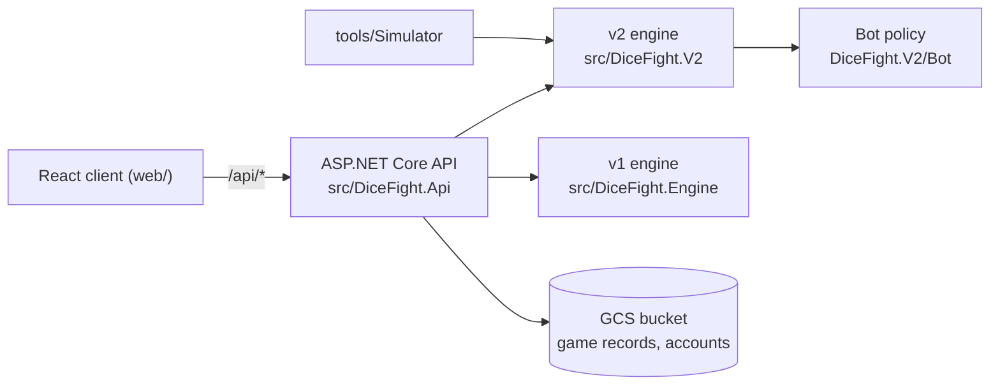

# Dice Kingdom (DiceFight2026)

Dice Kingdom is a mobile-friendly web game that began as a fan re-creation of the Dice Masters dice-building game and became its own animal-themed game on the same engine. You buy dice with energy you roll, field creatures, and attack. You can play against the computer, against a friend through an invite link, pass-and-play on one device, or climb a boss ladder. Dice roll in 3D (three.js and cannon-es physics). Coins earned in play buy card packs that grow a collection. Accounts are passwordless: a device plays anonymously, and you link more devices to the same player with a short code.

Live: https://dicefight2026-999266422848.us-central1.run.app/dice-kingdom/mobile

This is a personal learning project. It is not affiliated with or endorsed by the makers of Dice Masters. The Dice Kingdom card art is public-domain or CC0 natural-history artwork (see `web/public/dice-kingdom/art/CREDITS.txt`).

## Try it

**In 30 seconds:** open the live link, choose to play the computer, pick a Champion, and start. Each turn you draw dice from your bag, roll them, spend energy faces to buy dice or field creature faces, then attack. [How to Play](https://dicefight2026-999266422848.us-central1.run.app/dice-kingdom/how-to-play) has the full rules.

**Locally** (needs the .NET 10 SDK and Node 22):

```sh
dotnet run --project src/DiceFight.Api          # API on http://localhost:5284
cd web && npm ci && npm run dev                 # UI on http://localhost:5173, proxies /api
# then open http://localhost:5173/dice-kingdom/mobile
```

**Tests:**

```sh
dotnet test DiceFight.slnx      # three xUnit projects
cd web && npm test              # node:test unit tests for client logic
cd web && npm run build         # type-check (tsc -b) and production build
```

## Architecture

- **Back end:** ASP.NET Core on .NET 10 (`src/DiceFight.Api`). It holds games in memory, runs the bot opponent, and stores game records and player accounts in a Google Cloud Storage bucket (or a local folder in development).
- **Rules engines:** `src/DiceFight.Engine` (v1, a faithful Dice Masters simulation) and `src/DiceFight.V2` (v2, a smaller templated engine that Dice Kingdom runs on). Both are plain libraries with no web dependency.
- **Front end:** React 19, TypeScript and Vite (`web/`), with a hand-rolled router. `/dice-kingdom/mobile` is the main game; `/dice-kingdom` is a separate desktop layout; `/teambuilder` is the v1 Dice Masters team builder and card search.
- **Build and deploy:** one multi-stage `Dockerfile` builds the web app and the API into a single container that serves both from one origin. It runs on Google Cloud Run, and a Cloud Build trigger (configured in GCP, not in this repo) redeploys on every push to `main`.
- **Tools:** `tools/Simulator` plays every Champion pairing bot against bot for balance checks; `tools/GameRecords` and `tools/CardCatalogDocs` read recorded games and generate the card list.



**How a card ability is represented in v2.** A card is data. Each ability is a trigger, an optional filter, an optional cost, and an effect built from a closed set of templates: 11 trigger kinds, 21 effect templates, 8 continuous templates, 8 conditions, 5 amount kinds, and 3 durations. For example, "when this die is fielded, deal 2 damage to a target opposing character die" is a `DieFielded` trigger with a `DealDamage` effect whose target is a `TargetFilter`. The engine is a turn state machine plus an event bus that fires triggers, a query pipeline that applies continuous effects when a stat or legality is read, and one interpreter for the effect templates. Game rules such as draw count, energy symbols, and dice faces come from a config (`DiceKingdomConfig.cs`, `DiceFightClassicConfig.cs`), so Dice Masters and Dice Kingdom are two configs on the same engine. The full vocabulary is in [V2_VOCABULARY.md](V2_VOCABULARY.md).

## From v1 to v2

**v1 (July and August 2026)** aimed at full rules fidelity. Abilities were written in an effect DSL that was meant to be a small set of reusable primitives. After one full set (Dark Phoenix Saga, 145 cards) was implemented, an [architecture review](ARCHITECTURE_REVIEW.md) ([3aece10](https://github.com/yort5/DiceFight2026/commit/3aece10)) counted what had actually happened:

- 49 effect node types, 23 of them used by exactly one card;
- a target spec that had grown to 25 parameters, nearly each one added for a single card;
- 39 bespoke `Grants*` flags on the card definition, one per card with no reuse, checked in scattered places across the engine.

The reference catalog in the repo has 3,884 Dice Masters cards (`src/DiceFight.Engine/Data/BulkCards.json`). At that rate, the engine would keep growing with every set, and most cards would need their own code.

**v2 (August 22 to September 1, 2026)** started over in a separate project and left v1 running as a reference to check behavior against. The idea was that the card text adapts to the engine, not the engine to the card text:

- A **closed vocabulary**. A card that doesn't fit goes on a list in [V2_TAIL_POLICY.md](V2_TAIL_POLICY.md) as approximate or vanilla, and the vocabulary only grows with explicit sign-off. It grew twice after it was frozen ([5420431](https://github.com/yort5/DiceFight2026/commit/5420431)).
- **Continuous effects as data** (eight templates read by a query pipeline) instead of flags checked inside the engine.
- **Dice, energy, and turn rules as config**, which later made Dice Kingdom possible as a new game with no engine fork.
- **Checked on paper first.** Phase 0 re-expressed 20, then 60 real cards against the proposed vocabulary before any engine code was written. [V2_PLAN.md](V2_PLAN.md) set phases with stop-and-ask thresholds.

All 145 Dark Phoenix Saga cards were migrated ([d790783](https://github.com/yort5/DiceFight2026/commit/d790783)), each one as full, partial, or tailed. At that point the v2 core engine (excluding card data and the bot) was about 4,700 lines, against v1's 8,100 for the same set.

**Trade-offs accepted.** v2 cannot express several things v1 could, or that printed cards need: interrupting or cancelling another ability (Blink), "when an opponent targets your die" (Angel), payment-source tracking (several Bishop and Professor X cards), Continuous Basic Actions, tokens, and counting KOs this turn. Some cards play as an approximation, and others are vanilla, showing their text with no effect. Dice Kingdom avoids most of this because its card pool is written to fit the vocabulary. The [addendum to the review](ARCHITECTURE_REVIEW.md#addendum--after-v2-shipped-2026-09-02) ([7846890](https://github.com/yort5/DiceFight2026/commit/7846890)) records what the v2 bet got right and the one failure mode it missed: vocabulary shapes that existed in the types but were never wired to engine code.

## How this was built

Claude Code wrote nearly all of the code and docs (511 of 526 commits are authored by Claude). Claude Design produced the visual handoffs for the match screen, the team builder, and the die status cues (`v3/design_handoff_die_status_cues/`). I chose the direction (v1 to v2 to Dice Kingdom), made the rules rulings, set scope, and playtested. A second contributor sent UI and card changes through pull requests. [DESIGN_LOG.md](DESIGN_LOG.md) (v1 and v2) and [v3/DESIGN_NOTES.md](v3/DESIGN_NOTES.md) (Dice Kingdom) are the running record of each iteration, including mistakes.

**What worked**

- **Plans written for handoff.** V2_PLAN.md settles the architecture up front and forbids the implementing session from improvising it. Vocabulary changes needed my sign-off, so they arrived as written proposals, not drive-by edits.
- **Design docs as memory.** Each session starts from a "start here" status block and logs its decisions as it goes. That kept long-running work consistent across many sessions.
- **Tests as the check on generated card definitions.** Writing tests for migrated cards caught wrong card definitions, such as the wrong target kind and a protection scoped to one die instead of the team (DESIGN_LOG "DPS batch 9"). A catalog-wide invariant test caught a keyword the config never declared ([30955fa](https://github.com/yort5/DiceFight2026/commit/30955fa)).

**Where AI output needed correction**

- **The v1 DSL sprawl itself.** Each card was added competently on its own terms, and the pattern only showed when I asked for a step back and a count.
- **Confident but wrong claims.** Four cards were reported as missing from the source data when they were present. The causes were a typo and stale imported data ([421a614](https://github.com/yort5/DiceFight2026/commit/421a614)). The v2 plan also described a v1 test suite to port that did not exist (V2_PLAN.md, Phase 8 Task 5).
- **"It compiles" is not "it works."** A deployed route served the wrong page until a click-through on the real URL caught it ([eb928af](https://github.com/yort5/DiceFight2026/commit/eb928af)). `tsc --noEmit -p .` silently checks nothing in this repo's solution-style tsconfig, so `npm run build` is the real check. UI fixes sometimes needed a second round after screenshots (DESIGN_LOG "Match-table redesign, round 3").
- **Design handoffs vs. the code.** The Claude Design handoffs were written against the repo, but they still conflicted with engine facts such as die face composition, and each one needed a review pass before it was built (DESIGN_LOG "Match-table redesign, stage 1").

**What I would do differently:** run the architecture count after 20 cards, not 145. Require every new vocabulary shape to land with its engine consumer and one firing test. Keep the status docs shorter, because DESIGN_LOG.md is now over 11,000 lines and some status headers have gone stale (see below).

## Testing

- `tests/DiceFight.Engine.Tests` (v1, 580 tests), `tests/DiceFight.V2.Tests` (v2 and Dice Kingdom, 618), and `tests/DiceFight.Api.Tests` (API, accounts, packs, bosses, game recording, 114) all passed on 2026-11-15.
- `web/tests` has 86 node:test tests of client logic (payments, lane rules, die motion, card text). There are no React component tests.
- UI changes were checked by hand with headless Chromium screenshots. Those scripts live outside the repo, so there are no automated end-to-end tests here.
- Balance is checked with `tools/Simulator` (`cd tools/Simulator && dotnet run -c Release`).
- There is no CI test gate in the repo. The deploy trigger builds the image, which runs the web type-check, but not the .NET tests (`tests/` is excluded from the Docker build).

## Status and limitations

- **Done:** Dice Kingdom is playable end to end on mobile and desktop: vs. computer, vs. a friend, pass-and-play, the boss ladder, coins and packs, accounts, and game records with replay.
- **Rough:** the mobile and desktop UIs are separate code paths. The v1 Dice Masters engine and `/teambuilder` still ship, but work since September has gone into Dice Kingdom. Games live in server memory and are rebuilt from records when needed, so the service assumes one instance.
- **Not built:** email sign-in (accounts link devices by code only), bot personas per Champion, and the v2 tail gaps listed above.
- The API process also hosts some unrelated Discord bots (`src/DiceFight.DiscordBot`), which are off unless a token is configured.
